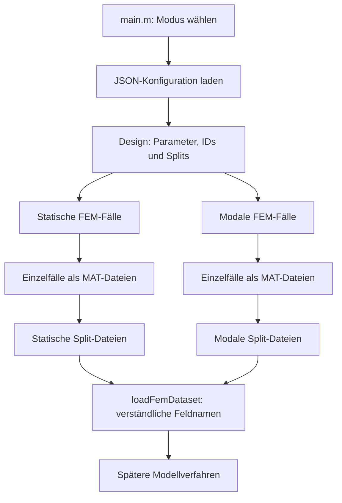

> Historischer Stand. Aktive Bedienung: README.md und runStaticStudy.m. `main` ohne Argument startet keine Berechnung mehr.

# Code v2 – FEM-Datenerzeugung und Datenschnittstelle

Diese Dokumentation beschreibt den aktuellen Aufbau von Code v2. Der Workflow
erzeugt FEM-Referenzdaten für zwei Aufgaben: statische Verschiebungsfelder und
modale Eigenfrequenzen. Später können verschiedene Verfahren dieselben Daten
laden und ihre Vorhersagen auf einer gemeinsamen Grundlage vergleichen.

Die Beschreibung bezieht sich auf den implementierten Code. Der ursprüngliche
Lauf hat alle sechs Split-Dateien erzeugt. Die anschließend eigenständig
gemachte FEM-Berechnung wurde noch nicht durch einen neuen FEM-Lauf geprüft;
auch die separate Ladefunktion wurde noch nicht vollständig verifiziert.

## 1. Überblick und Architektur



| Bestandteil | Aufgabe |
|---|---|
| `main.m` | Zentraler Einstieg; wählt Konfiguration, Ausgabeordner und Rechenphasen. |
| `scripts/matlab/run_data_generation_v2.m` | Erstellt Designs, steuert FEM-Fälle, prüft vorhandene Ergebnisse und stellt Splits zusammen. |
| `data_generation/configs/data_generation_v1.json` | Einstellungen für die eigentliche Datenerzeugung. |
| `data_generation/configs/smoke_v1.json` | Kleine Konfiguration für einen separaten Probelauf. |
| `loadFemDataset.m` | Lädt eine Split-Datei in eine Struktur mit sprechenden Feldnamen. |
| `fem_core` | Lokale FEM-Löser und benötigte Hilfsfunktionen. |

Code v2 verwendet lokale Kopien der benötigten FEM-Funktionen unter `fem_core`.
Der benachbarte Ordner `Code` wird für die Datenerzeugung nicht benötigt.

## 2. Start in MATLAB

Voraussetzungen sind MATLAB R2025b, die Partial Differential Equation Toolbox
und Java für die SHA-256-Prüfung. In MATLAB `Code v2` als aktuellen Ordner wählen:

```matlab
main                 % Alle Trainings-, Validierungs- und Testfälle
main("train_val")    % Nur Trainings- und Validierungsfälle
main("test")         % Nur Testfälle
main("smoke")        % Kleiner, separat gespeicherter Probelauf
```

`main` ohne Argument startet alle Splits einschließlich Test. Für eine
unabhängige Abschlussbewertung empfiehlt sich stattdessen zunächst
`main("train_val")` und erst nach der Modellauswahl `main("test")`. Das ist
eine Arbeitsregel; das Programm prüft keinen Modell-Freeze und verhindert einen
vorzeitigen Testlauf nicht.

Die Berechnung läuft fallweise und kann lange dauern. Die Zeit hängt vom Rechner
und von den FEM-Netzen ab. Der Runner setzt den lokalen FEM-Kern für die Dauer
des Aufrufs auf den MATLAB-Pfad.

## 3. Fallzahlen und Smoke-Test

| Datensatz | Training | Validierung | Test | Gesamt |
|---|---:|---:|---:|---:|
| Statische Verschiebungsfelder | 384 | 12 | 64 | 460 |
| Modale Eigenfrequenzen | 384 | 12 | 64 | 460 |

Der vollständige Lauf umfasst damit bis zu 920 FEM-Fälle. Ein Smoke-Test nutzt
je Berechnungsart zwei Trainings-, einen Validierungs- und einen Testfall –
insgesamt acht FEM-Fälle. Seine Ausgabe liegt in `data_generation/smoke`, die
eigentliche Studie in `data_generation/data`.

Ein erfolgreicher Smoke-Test prüft den Ablauf an wenigen Beispielen. Er beweist
weder, dass alle Fälle des großen Parameterbereichs erfolgreich sind, noch dass
die gewählte FEM-Netzfeinheit ausreichend genau ist.

## 4. Ablauf eines Laufs

1. `main` bestimmt anhand des Modus die JSON-Konfiguration und den Ausgabeordner.
2. Der Runner bindet den lokalen FEM-Kern ein und lädt die Konfiguration.
3. Er schreibt oder prüft Herkunftsinformationen und erstellt statisches und
   modales Design. Ein Design enthält Fall-ID, Eingabeparameter und Split.
4. Für jeden ausgewählten Fall lädt der Runner ein passendes vorhandenes
   Einzelergebnis oder ruft den jeweiligen FEM-Löser auf.
5. Jedes neu berechnete Ergebnis wird als einzelne MAT-Datei gespeichert.
6. Nach der Fallbearbeitung werden die ausgewählten Splits aus ihren Einzelfällen
   zu `train.mat`, `val.mat` beziehungsweise `test.mat` zusammengestellt.

Das Design wird mit einem festen Seed und einem Latin-Hypercube-Verfahren
erzeugt: Für jeden Parameter wird dessen konfigurierter Bereich in Intervalle
unterteilt und daraus werden Werte gezogen. Statische und modale Designs sind
getrennt. Das Design enthält auch die Testparameter; FEM-Testlabels entstehen
erst beim entsprechenden Testschritt oder beim Gesamtlauf `main`.

## 5. Parameter und FEM-Modell

Die Eingaben stehen in SI-Einheiten. Die Reihenfolge der sechs Spalten ist für
Statik und Modalrechnung bis auf die letzte Spalte gleich:

| Spalte | Statisch | Modal |
|---|---|---|
| 1 | Länge `L_m` [m] | Länge `L_m` [m] |
| 2 | Breite `b_m` [m] | Breite `b_m` [m] |
| 3 | Höhe `h_m` [m] | Höhe `h_m` [m] |
| 4 | Elastizitätsmodul `E_Pa` [Pa] | Elastizitätsmodul `E_Pa` [Pa] |
| 5 | Querkontraktionszahl `nu` [-] | Querkontraktionszahl `nu` [-] |
| 6 | Kraft `Fz_N` [N] | Dichte `rho_kg_m3` [kg/m³] |

Die statische Berechnung verwendet ein dreidimensionales linear-elastisches
Balkenmodell mit einer Einspannung und einer gleichmäßig verteilten Belastung
auf der gegenüberliegenden Stirnfläche. Die modale Berechnung ermittelt
ungedämpfte Eigenfrequenzen des eingespannten Balkens. Der Datensatz speichert
die ersten sechs Frequenzen, aber keine Eigenformen.

Die aktuellen Parametergrenzen und FEM-Einstellungen stehen in der JSON-Datei.
Vor einem neuen Lauf sollten sie anhand der wissenschaftlichen Fragestellung
geprüft werden; ihre bloße Konfiguration bestätigt noch keine FEM-Konvergenz.

## 6. Ausgabe und Wiederaufnahme

```text
data_generation/
├── configs/
│   ├── data_generation_v1.json
│   └── smoke_v1.json
├── data/                         # eigentliche Studie
│   ├── provenance.txt
│   ├── design_config_sha256.txt
│   ├── static/
│   │   ├── design.csv
│   │   ├── cases/case_<ID>.mat
│   │   ├── train.mat
│   │   ├── val.mat
│   │   └── test.mat
│   └── modal/
│       ├── design.csv
│       ├── cases/case_<ID>.mat
│       ├── train.mat
│       ├── val.mat
│       └── test.mat
└── smoke/                        # gleicher Aufbau für den Probelauf
```

Die Ordner und Dateien entstehen je nach ausgeführten Phasen. Insbesondere
existiert eine Split-Datei erst nach erfolgreicher Zusammenstellung; während
eines laufenden oder unterbrochenen Schritts können bereits Einzelfälle ohne
fertige Split-Datei vorhanden sein.

Beim erneuten Aufruf prüft der Runner vorhandene Einzelfälle auf ID, Split und
Parameter. Passende Fälle werden übersprungen; bei Konflikten bricht der Lauf
ab. Vorhandene Split-Dateien werden mit den zusammengestellten Daten verglichen
und nicht absichtlich ersetzt. Die Herkunftsdatei erfasst Hashes der
Konfiguration und ausgewählter Quelldateien sowie MATLAB- und
PDE-Toolbox-Version. Eine Änderung daran führt beim Fortsetzen zu einem Konflikt.
Sie erfasst nicht zwangsläufig alle indirekten Abhängigkeiten. Für einen neuen
Studienstand ist ein eigener Ausgabeordner sinnvoll.

Eine einzelne Fall-Datei enthält die Struktur `value` mit unter anderem `id`,
`split`, `parameters`, `parameterNames`, `payload` und Erstellungszeit. Die
zusammengefassten Split-Dateien enthalten jeweils die Struktur `D`.

## 7. Gemeinsame Datenschnittstelle

Alle Split-Dateien besitzen die Felder `D.schema`, `D.modality`, `D.split`,
`D.id`, `D.X` und `D.seconds`. In `D.X` steht **ein Fall pro Zeile**; die
zugehörige Fallnummer steht in derselben Zeile von `D.id`.

Die Zahl der Fälle ist abhängig vom Split: Für die Hauptkonfiguration sind es
384 Training, 12 Validierung und 64 Test. Im Folgenden bezeichnet `N` die Zahl
der Fälle im jeweils geladenen Split.

### 7.1 Statische Verschiebungsfelder

| Feld | Größe | Bedeutung |
|---|---:|---|
| `D.X` | N × 6 | Eingabeparameter; ein Fall pro Zeile. |
| `D.S` | 1575 × N | Verschiebungsfelder; ein Fall pro Spalte. |
| `D.Y` | N × 2 | Zwei skalare Antwortgrößen pro Fall. |
| `D.xi` | 3 × 525 | Normierte Koordinaten des gemeinsamen Referenzgitters. |
| `D.w` | 1575 × 1 | Gewichte für die drei Komponenten des Feldes. |
| `D.id` | N × 1 | Fall-IDs. |
| `D.seconds` | N × 1 | Rechenzeit pro Fall in Sekunden. |
| `D.nodes` | N × 1 | Anzahl der FEM-Netzknoten pro Fall. |

Das konfigurierte Referenzgitter hat `21 × 5 × 5 = 525` Punkte. Je Punkt
werden drei Verschiebungskomponenten in Metern gespeichert. Ein Feldvektor in
`D.S(:,i)` enthält zuerst alle 525 `ux`-Werte, dann alle `uy`-Werte und danach
alle `uz`-Werte. Das Gitter ist normiert und für alle Fälle gleich; es ist nicht
das jeweils verwendete native FEM-Netz. `D.w` enthält die Gittergewichte jeweils
für alle drei Komponenten.

In `D.Y(:,1)` steht die Verschiebung in z-Richtung am Mittelpunkt der freien
Stirnfläche. `D.Y(:,2)` enthält den maximalen Verschiebungsbetrag auf dem
ausgewerteten Gitter, nicht zwingend das exakte Maximum im gesamten Bauteil.

### 7.2 Modale Eigenfrequenzen

| Feld | Größe | Bedeutung |
|---|---:|---|
| `D.X` | N × 6 | Eingabeparameter; ein Fall pro Zeile. |
| `D.frequencyHz` | N × 6 | Erste sechs Eigenfrequenzen pro Fall in Hz. |
| `D.modeIndices` | 6 × 1 | Indizes der gespeicherten Frequenzen: 1 bis 6. |
| `D.frequencyUnit` | Text | Einheit `Hz`. |
| `D.id` | N × 1 | Fall-IDs. |
| `D.seconds` | N × 1 | Rechenzeit pro Fall in Sekunden. |

Bei modalem `D.X` und `D.frequencyHz` stehen die Fälle jeweils in den Zeilen.
Die Frequenzindizes sind sortierte Positionen; der Datensatz enthält keine
zusätzliche Zuordnung von Modenfamilien oder Eigenformen.

## 8. Daten mit verständlichen Feldnamen laden

Die Funktion `loadFemDataset` liest die gespeicherte Struktur `D` und gibt eine
neue Struktur mit verständlichen Namen zurück. Sie ändert die MAT-Datei nicht.
Die Datei `design.csv` muss im selben Ordner wie die Split-Datei liegen: Aus
ihrer Kopfzeile liest die Funktion die Parameterbezeichnungen.

```matlab
data = loadFemDataset(fullfile("data_generation", "data", ...
    "static", "train.mat"));

parameter = data.inputParameters(5,:);       % Eingaben von Fall 5
feld = data.displacementFields(:,5);         % Feld von Fall 5
fallnummer = data.caseIds(5);
```

| Gespeichert | Name nach dem Laden |
|---|---|
| `D.X` | `data.inputParameters` |
| `D.id` | `data.caseIds` |
| `D.seconds` | `data.computationTimeSeconds` |
| `D.S` | `data.displacementFields` |
| `D.Y(:,1)` | `data.tipDisplacementZ` |
| `D.Y(:,2)` | `data.maxDisplacementMagnitudeOnGrid` |
| `D.xi` | `data.normalizedGridCoordinates` |
| `D.w` | `data.displacementComponentWeights` |
| `D.nodes` | `data.meshNodeCounts` |
| `D.frequencyHz` | `data.naturalFrequenciesHz` |

Nicht jedes Feld existiert für beide Berechnungsarten. Zusätzlich enthält die
geladene Struktur `parameterNames`, `schema`, `modality` und `split`; bei modalen
Daten auch `modeIndices` und `frequencyUnit`. Die ursprünglichen MAT-Dateien
behalten ihre kurzen Feldnamen. Die Loader-Funktion wurde bisher nicht in einem
vollständigen FEM-Ablauf verifiziert.

## 9. Verwendung für spätere Modellverfahren

Ein statisches Modell lernt die Zuordnung von `inputParameters` zu
`displacementFields`; ein modales Modell die Zuordnung von `inputParameters` zu
`naturalFrequenciesHz`. Manche Verfahren erwarten alle Fälle zeilenweise. Für
statische Felder ist dann eine Transposition von `displacementFields` nötig.

Vorverarbeitung wie Skalierung sollte anhand der Trainingsdaten bestimmt und
anschließend unverändert auf Validierungs- und Testdaten angewendet werden.
Für einen fairen Vergleich sollten Verfahren dieselben Splits und dieselben
Fehlerdefinitionen verwenden. Eine gemeinsame Fehlerauswertung, eine umfassende
Validierung der Schnittstelle und eine Erweiterung für Eigenformen sind noch
nicht Teil dieses Workflows.
