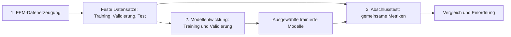
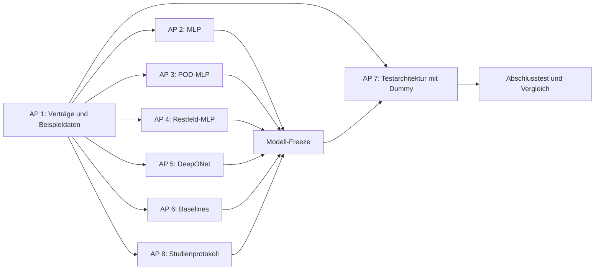

> Historischer Stand. Aktive Bedienung: README.md und runStaticStudy.m. `main` ohne Argument startet keine Berechnung mehr.

# Projektplan: FEM-Daten, Ersatzmodelle und Modellvergleich

**Zweck:** Arbeitsgrundlage für die Aufteilung im Team. Die Arbeitspakete sind
Vorschläge für eigenständig bearbeitbare Aufgaben, keine Festlegung auf eine
bestimmte Person und kein bereits durchgeführter Modellvergleich.

**Grundlage:** Die Aufgabenstellung im Ordner `Projektbeschreibung`, die
Literaturübersichten im Ordner `Recherche` sowie der bestehende Code-v2-Workflow.
Die Aufgabenstellung untersucht neuronale Ersatzmodelle für einen eingespannten
Biegebalken, zunächst für statische Auslenkung und anschließend für
Eigenfrequenzen. Dabei sollen unter anderem Netzarchitektur, Training und Umfang
der Trainingsdaten untersucht werden.

## 1. Ziel und Grundidee

FEM-Referenzrechnungen werden getrennt von der Modellentwicklung durchgeführt.
Die dabei erzeugten Datensätze bilden eine festgelegte Schnittstelle. Darauf
aufbauend implementieren verschiedene Teammitglieder unabhängig voneinander
Ersatzmodelle. Eine separate Testarchitektur vergleicht die ausgewählten Modelle
auf denselben Testfällen und mit denselben Metriken.

Ziel ist, für den untersuchten Parameterbereich zu beurteilen, ob ein Modell die
FEM-Ergebnisse hinreichend genau und mit geringerem Vorhersageaufwand
approximieren kann. Dass ein Modell trainierbar ist, allein belegt noch nicht,
dass es die FEM für den vorgesehenen Zweck ersetzen kann.



Die drei Bereiche haben unterschiedliche Verantwortlichkeiten:

| Bereich | Verantwortung | Ergebnis |
|---|---|---|
| Datenerzeugung | FEM-Fälle und feste Splits erzeugen und dokumentieren. | Statische und modale Referenzdatensätze. |
| Modellentwicklung | Modellvarianten trainieren, validieren und auswählen. | Gespeicherte, ausgewählte Modelle. |
| Abschlusstest | Festgelegte Modelle auf denselben Testfällen bewerten. | Vergleichbare Kennzahlen und Berichte. |

Training und Validierung bilden organisatorisch einen Bereich. Die Datenrollen
bleiben getrennt: Trainingsdaten bestimmen Modellparameter; Validierungsdaten
helfen bei der Auswahl. Testdaten dienen der anschließenden Bewertung des
festgelegten Modells.

## 2. Ausgangslage und Grenzen

- `main.m` und der Runner in Code v2 erzeugen Designs und FEM-Referenzen für
  statische Verschiebungsfelder und modale Eigenfrequenzen. Die Berechnung nutzt
  lokale FEM-Löser aus `fem_core` und benötigt den benachbarten Ordner `Code`
  nicht.
- Die Hauptkonfiguration sieht pro Berechnungsart 384 Trainings-, 12
  Validierungs- und 64 Testfälle vor. Der tatsächliche Fortschritt kann sich
  ändern und ist vor der Nutzung anhand der Dateien zu prüfen.
- Bereits erzeugte MAT-Dateien enthalten die Struktur `D` mit kurzen Feldnamen.
  `loadFemDataset.m` stellt beim Lesen verständliche Namen bereit. Diese
  Übersetzung ändert die gespeicherten Dateien nicht.
- Der aktuelle FEM-Lauf und dessen Dateien werden bei der Entwicklung der
  nachfolgenden Arbeitspakete nicht verändert. Vor Studienbeginn sind Abschluss,
  Integrität und wissenschaftliche Eignung der Daten zu prüfen.
- Frühere Studien und Implementierungen aus dem bestehenden Projekt sind
  fachliche Referenzen. Die hier geplanten Verfahren werden neu implementiert;
  historische Resultate sind keine Ergebnisse auf dem neuen Datensatz.
- Die modalen Code-v2-Daten enthalten sechs Eigenfrequenzen pro Fall, aber keine
  Eigenformen. Modenformen oder Modenfamilien lassen sich damit nicht bewerten.

## 3. Gemeinsame Schnittstellen

Die Schnittstellen werden zu Beginn gemeinsam festgelegt. Danach dürfen die
Arbeitspakete intern unterschiedlich implementiert sein, müssen aber dieselben
Eingaben verstehen und vergleichbare Ausgaben liefern.

### 3.1 Datenschnittstelle

Der gemeinsame Loader stellt Trainings-, Validierungs- und Testsplit getrennt
bereit. Feldnamen und Formate werden dokumentiert und mit synthetischen wie
realen Daten geprüft.

| Aufgabe | Eingabeparameter | FEM-Zielgröße |
|---|---|---|
| Statik | `inputParameters`, N × 6 | `displacementFields`, 1575 × N |
| Modal | `inputParameters`, N × 6 | `naturalFrequenciesHz`, N × 6 |

Für beide Aufgaben sind die ersten fünf Parameter Länge `L_m`, Breite `b_m`,
Höhe `h_m`, Elastizitätsmodul `E_Pa` und Querkontraktionszahl `nu`. Der sechste
Parameter ist statisch die Kraft `Fz_N`, modal die Dichte `rho_kg_m3`.

Bei der Statik enthält jede Feldspalte die Verschiebungen in Metern: zuerst
525 Werte für `ux`, danach 525 für `uy` und zuletzt 525 für `uz`. Die 525
Punkte bilden das gemeinsame normierte Gitter `21 × 5 × 5`. Gitterkoordinaten,
Gewichte, Fall-IDs, Einheiten und Parameterreihenfolge gehören zum Vertrag.
Bei der Modalrechnung enthält jede Zeile sechs Frequenzen in Hz, geordnet nach
den gespeicherten Frequenzpositionen.

**Wichtig:** In der Statik stehen Fälle in `inputParameters` in Zeilen, in
`displacementFields` dagegen in Spalten. Ein Modell darf intern ein anderes
Format nutzen, muss dies aber an der gemeinsamen Schnittstelle umsetzen.

Ein Modelltraining erhält nur den Trainingssplit und die für die Auswahl
vorgesehene Validierung. Der Testbereich erhält Testlabels erst nach dem
Modell-Freeze. Wenn Testlabels bereits für Auswahlentscheidungen verwendet
wurden, muss das dokumentiert und ein unabhängiger Abschlusstest neu geplant
werden.

### 3.2 Modellschnittstelle

Jedes Verfahren stellt dieselben Fähigkeiten bereit. Die unten genannten Namen
sind ein Schnittstellenentwurf; die endgültige MATLAB-Signatur wird in AP 1 mit
den Modell- und Testteams abgestimmt.

```text
train(trainData, validationData, config) → model, validationReport
predict(model, inputParameters)          → predictions
save/load                                → wiederverwendbares Modellartefakt
```

- Die statische Vorhersage hat die Größe 1575 × N und verwendet die vereinbarte
  Gitter- und Komponentenreihenfolge. Die modale Vorhersage hat N × 6 in Hz.
- Das Artefakt enthält Modellparameter, trainierte Vorverarbeitung und
  Rekonstruktionsinformationen, Parameterreihenfolge, Modelltyp, Konfiguration,
  Seed, Datenkennung und Auswahlmetrik. Eine Vorhersage benötigt keinen FEM-Lauf.
- Ungültige Eingabedimensionen, unbekannte Datenformate und nicht endliche
  Eingaben oder Ausgaben werden mit nachvollziehbaren Fehlern behandelt.
- Training, Speicherung und Vorhersage sind je Verfahren gekapselt. Die
  Testarchitektur ruft die gemeinsame Schnittstelle auf und kennt keine
  verfahrensspezifischen Details.

## 4. Arbeitspakete für das Team

Die Pakete sind so formuliert, dass sie an verschiedene Personen vergeben
werden können. Mehrere Pakete können auch von derselben Person bearbeitet werden.
Vor der parallelen Umsetzung werden die Schnittstellen gemeinsam abgestimmt.

### AP 1 – Daten- und Modellvertrag

**Ziel:** Eine verlässliche Grundlage für alle Modell- und Testpakete schaffen.

**Aufgaben:**

1. Das tatsächliche Code-v2-Format und `loadFemDataset` prüfen und die oben
   beschriebenen Feldnamen, Dimensionen, Einheiten und Fallzuordnungen verbindlich
   dokumentieren.
2. Die Lade- und Prüfmechanismen für beide Aufgaben und alle Splits festlegen.
   Die laufende Datenerzeugung und vorhandene Ergebnisdateien bleiben unverändert.
3. Einen gemeinsamen Modellvertrag und das Format des gespeicherten Artefakts
   mit den Teams der Modellverfahren und des Abschlusstests abstimmen.
4. Kleine synthetische Beispieldatensätze und ein einfaches Dummy-Modell für
   die parallele Entwicklung bereitstellen.

**Eingaben:** Code-v2-Konfiguration, MAT-Struktur, Design-CSV und Dokumentation.

**Ergebnisse:** Versionierte Schnittstellenbeschreibung, Loader, Prüfroutinen,
Beispieldaten und Dummy-Modell.

**Abnahme:** Statische und modale Beispieldaten lassen sich konsistent laden;
Dimensionen, IDs, Splits und Parameterreihenfolge werden geprüft. Falsche oder
unvollständige Eingaben führen zu verständlichen Fehlern.

### AP 2 – Direktes MLP

**Ziel:** Eine verständliche neuronale Baseline für beide Aufgaben schaffen.

**Aufgaben:** Ein vollständig verbundenes Netz für die statischen Felder und
ein separates Netz für die sechs Eigenfrequenzen neu implementieren. Architektur
und Trainingsparameter konfigurierbar machen. Eingabe- und Ausgabenormierung nur
aus Trainingsdaten bestimmen und im Modellartefakt speichern.

**Eingaben:** Trainings- und Validierungsdaten gemäß AP 1; Studienkonfiguration.

**Ergebnisse:** Trainierte, speicherbare MLP-Modelle, Validierungsbericht und
Vorhersagefunktion für beide Aufgaben.

**Abnahme:** Modell kann trainiert, gespeichert, geladen und über den Vertrag
aufgerufen werden; Vorhersagen haben die vereinbarte Größe und endliche Werte.

### AP 3 – POD-MLP für statische Felder

**Ziel:** Prüfen, ob sich ein hochdimensionales Feld über wenige POD-Koeffizienten
effizient vorhersagen lässt.

**Aufgaben:** Eine gewichtete POD-Basis ausschließlich aus den jeweiligen
Trainingsfeldern berechnen. Ein MLP zur Koeffizientenvorhersage trainieren und
die Koeffizienten auf das vollständige Feld zurückführen. Rang und
Validierungsauswahl dokumentieren. Bei Cross-Validation die Basis innerhalb jedes
Folds erneut nur aus dessen Trainingsanteil bestimmen.

**Eingaben:** Statische Trainings- und Validierungsdaten einschließlich Gewichten.

**Ergebnisse:** POD-Basis und Vorverarbeitung im Modellartefakt, trainiertes
Koeffizientennetz und vollständige Feldvorhersage.

**Abnahme:** Das Modell liefert 1575 × N in der vereinbarten Reihenfolge;
Speichern und Laden erhalten Vorhersagen und Rekonstruktionsinformationen.

### AP 4 – Physikgestütztes Restfeld-MLP

**Ziel:** Eine analytische Balkennäherung mit einer gelernten FEM-Korrektur
vergleichen.

**Aufgaben:** Die analytische Näherung samt Koordinatensystem, Einheiten und
Annahmen ausdrücklich definieren. Die Differenz zwischen FEM-Feld und Näherung
auf dem gemeinsamen Gitter bestimmen; ein MLP auf dieses Restfeld trainieren.
Für die Ausgabe Näherung und Korrektur addieren.

**Eingaben:** Statische Trainings- und Validierungsdaten und analytisches Modell.

**Ergebnisse:** Dokumentierte Näherung, Restfeldmodell und gespeichertes Artefakt,
das das vollständige Verschiebungsfeld ausgibt.

**Abnahme:** Gemeinsamer Modellvertrag ist erfüllt; Randbedingungen, Bezugssystem
und Grenzen der Näherung sind nachvollziehbar. Die analytische Näherung wird
nicht als identisch mit der dreidimensionalen FEM-Lösung dargestellt.

### AP 5 – DeepONet

**Ziel:** Ein ortsabhängiges neuronales Feldmodell untersuchen.

**Aufgaben:** Ein DeepONet neu implementieren, das Eingabeparameter und Orte
verarbeitet. Für den einheitlichen Vergleich das Feld auf dem festgelegten
525-Punkte-Gitter ausgeben. Datenaufbereitung, Training und Validierung
dokumentieren. Zusätzliche Abfrageorte sind eine spätere Erweiterung.

**Eingaben:** Statische Trainings- und Validierungsdaten mit Gitterkoordinaten.

**Ergebnisse:** Trainiertes und speicherbares DeepONet samt Adapter auf die
gemeinsame Feldschnittstelle.

**Abnahme:** Vorhersagen auf dem Referenzgitter erfüllen Format, Einheiten und
Komponentenreihenfolge; Speichern und erneutes Laden funktionieren.

### AP 6 – Vergleichsbaselines

**Ziel:** Neuronale Ergebnisse anhand einfacher Referenzen einordnen.

**Aufgaben:** Eine analytische Balkennäherung für geeignete statische Kennwerte
und eine Gaussian Process Regression für die sechs Eigenfrequenzen implementieren.
Annahmen, Training und Ausgabegrößen dokumentieren. Kennwert- und
Vollfeldvergleiche nicht vermischen.

**Eingaben:** Passende Daten aus AP 1 und dokumentierte analytische Formeln.

**Ergebnisse:** Wiederverwendbare Baselines und reproduzierbare Vorhersagen.

**Abnahme:** Modale Baseline erfüllt den Frequenzvertrag; analytische Ergebnisse
werden nur für dieselbe physikalische Zielgröße und Einheit verglichen.

### AP 7 – Gemeinsame Testarchitektur

**Ziel:** Alle ausgewählten Modelle einheitlich und unabhängig von ihrem
Trainingscode bewerten.

**Aufgaben:** Einen Prüfstand entwickeln, der Modellartefakte und Testdaten lädt,
Vorhersagen berechnet, Metriken auswertet und Ergebnisse je Fall und Modell
speichert. Zunächst mit synthetischen Daten und dem Dummy-Modell aus AP 1
arbeiten. Testlabels erst nach dokumentiertem Modell-Freeze einlesen.

**Eingaben:** Daten- und Modellvertrag, eingefrorene Modellartefakte, Testsplit
und vorab definierte Metriken.

**Ergebnisse:** Gemeinsamer Testaufruf, Ergebnisse je Fall, Zusammenfassung und
Protokoll zu Modell-, Daten- und Auswertungsversion.

**Abnahme:** Bekannte Dummy-Vorhersagen ergeben rechnerisch überprüfbare
Metriken; alle echten Modellpakete bestehen denselben Schnittstellentest.

### AP 8 – Studienplanung, Auswertung und Dokumentation

**Ziel:** Die Aufgabenstellung in einen nachvollziehbaren Modellvergleich und
konkrete Experimente übersetzen.

**Aufgaben:** Vorab Modellvarianten, Kandidatenbudgets, Seeds, Trainingsgrößen,
Auswahlregel und Kennzahlen festlegen. Lernkurven und Zusammenfassungen planen;
Trainings-, Validierungs- und Testrollen dokumentieren. Ergebnisse einschließlich
fehlgeschlagener Läufe, Laufzeiten und wissenschaftlicher Grenzen einordnen.

**Eingaben:** Aufgabenstellung, Recherche, Schnittstellen und Berichte der
Modell- und Testpakete.

**Ergebnisse:** Versioniertes Studienprotokoll, Tabellen und Abbildungen sowie
eine abschließende, nachvollziehbare Ergebniseinordnung.

**Abnahme:** Ein Außenstehender kann erkennen, welche Fälle und Einstellungen
verwendet wurden, wie Modelle ausgewählt wurden und welche Aussagen der Test
unterstützt beziehungsweise nicht unterstützt.

## 5. Abhängigkeiten und Zusammenarbeit



1. Das Team stimmt Daten- und Modellvertrag ab. AP 1 stellt synthetische
   Beispieldaten und ein Dummy-Modell bereit.
2. AP 2 bis AP 6 können unabhängig voneinander umgesetzt werden. AP 7 kann
   parallel den Prüfstand entwickeln; AP 8 konkretisiert das Studienprotokoll.
3. Jedes Verfahren wird zunächst einzeln gegen den Vertrag geprüft. Danach
   werden kleine Pilotläufe und die vorab festgelegten Trainingsstudien ausgeführt.
4. Die Teams wählen Modelle anhand des Validierungsprotokolls aus und frieren
   Artefakte und Auswahlentscheidungen ein.
5. AP 7 wertet die festgelegten Modelle auf den gleichen Testfällen aus; AP 8
   erstellt den Vergleich und dokumentiert Grenzen.

## 6. Vorschlag für Studien- und Bewertungsplan

Dieser Abschnitt macht den Plan konkret, bleibt aber ein Vorschlag für die
gemeinsame Abstimmung im Team. Er ist kein Bericht über bereits erzielte Werte.

### Modellauswahl und Datenumfang

- Für vergleichbare Modellvarianten dieselben Trainings- und Validierungsfälle
  sowie eine vorab festgelegte Auswahlmetrik verwenden.
- Da zwölf feste Validierungsfälle wenig sein können, zusätzlich festgelegte
  Cross-Validation-Folds innerhalb der Trainingsdaten untersuchen. Normierung,
  POD und jede andere gelernte Vorverarbeitung jeweils nur aus dem
  Trainingsanteil des betreffenden Folds bestimmen.
- Als Lernkurve verschachtelte Trainingsgrößen von 12, 24, 48, 96, 192 und 384
  Fällen mit drei festgelegten Seeds untersuchen. Identische Fall-IDs pro Größe
  und Seed für vergleichbare Verfahren verwenden.
- Unterschiedliche Datenumfänge untersuchen noch nicht den Einfluss verschiedener
  Sampling-Verteilungen. Ein belastbarer Samplingvergleich benötigt mehrere
  getrennt geplante Designs und gegebenenfalls weitere FEM-Referenzen.

### Gemeinsame Metriken

- **Statisches Feld:** Gewichteten relativen Feldfehler je Fall sowie Median,
  95. Perzentil und Maximum berichten. Bei sehr kleinen Referenznormen absolute
  Fehler ergänzen und den Umgang mit dem Nenner vorab festlegen. Zusätzlich
  Spitzenverschiebung und Einspannungsabweichung untersuchen.
- **Eigenfrequenzen:** Absolute und relative Fehler je Frequenz und Fall sowie
  Median, 95. Perzentil und Maximum berichten. Der Vergleich betrifft die
  gespeicherten sortierten Frequenzpositionen, keine Eigenformen oder
  Modenfamilien.
- **Aufwand:** Trainings- und Vorhersagezeiten getrennt mit Hardware,
  MATLAB-Version, Messbedingungen und Anzahl von Wiederholungen dokumentieren.
  FEM-Zeiten nur unter geeigneten Bedingungen vergleichen. Eine mögliche
  Amortisation ausdrücklich als von den Messannahmen abhängige Abschätzung
  ausweisen.

### Testdisziplin

Testfälle nicht zur Auswahl von Architektur, Trainingsparametern oder Seeds
verwenden. Vor dem ersten Abschlusstest die ausgewählten Modelle, die
Auswahlregel und das Testprotokoll festhalten. Sind Testlabels bereits für eine
Modellentscheidung verwendet worden, wird ein neuer unabhängiger Test benötigt.

## 7. Gemeinsame Qualitäts- und Abschlusskriterien

- Jeder Beitrag hat einen dokumentierten Einstieg, eine Konfiguration, ein
  speicherbares Modell beziehungsweise einen klaren Testaufruf und einen kurzen
  Prüfbericht.
- Vertragstests prüfen statische und modale Dimensionen, Fallzuordnung,
  Einheiten, Split-Trennung und Fehlermeldungen mit synthetischen Daten.
- Jedes Modell wird trainiert, gespeichert, erneut geladen und mit identischen
  Eingaben auf reproduzierbare Vorhersagen geprüft; es berechnet bei der
  Vorhersage keine FEM.
- Der Prüfstand wird zuerst mit bekannten Dummy-Ausgaben getestet. Er funktioniert
  unabhängig davon, ob alle Verfahren bereits implementiert sind.
- Vor realen Studien werden die fertigen Code-v2-Datensätze auf Vollständigkeit,
  Integrität und Verwendbarkeit geprüft. Ergebnisse, Fehlversuche und ältere
  Studien werden nicht überschrieben.
- Die Abschlussauswertung nennt sowohl Genauigkeit und Aufwand als auch
  Einschränkungen. Eine Aussage über FEM-Ersatz gilt nur für die untersuchte
  Aufgabe, den Parameterbereich und die verwendeten Bewertungsfälle.

## 8. Spätere Erweiterungen und offene Entscheidungen

PINN, FNO, Graphnetze und Multi-Fidelity sind in der Recherche enthalten, werden
aber nicht als Voraussetzung des ersten Vergleichs festgelegt. Insbesondere
benötigen sie gegebenenfalls zusätzliche Physikformulierungen, andere
Datenrepräsentationen oder Referenzdaten unterschiedlicher Genauigkeit.

Vor Beginn der Umsetzung im Team festzulegen sind insbesondere Zuständigkeiten,
Zeitbudget, endgültige MATLAB-Signaturen, konkrete Kandidaten und Auswahlmetriken,
die praktikable Behandlung der kleinen Validierungsmenge sowie der Status der
Testlabels. Der eigenständige FEM-Kern ist bei weiteren Änderungen getrennt von
der Modellentwicklung zu pflegen.
