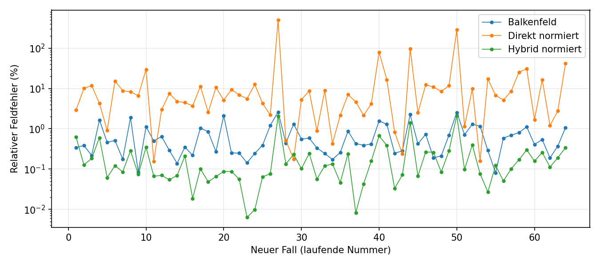
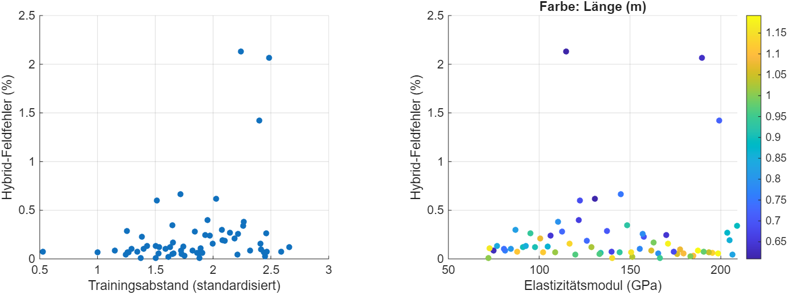
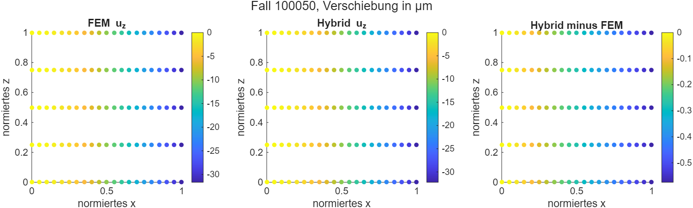

# Unabhängige Bestätigungsstudie: statische Verschiebungsfelder

## Fragestellung und Protokoll

Die drei eingefrorenen Verfahren wurden auf 64 neuen Parameterfällen innerhalb des dokumentierten Balkenparameterraums verglichen. Das vorab gespeicherte Protokoll legte Sampling, Modelle und Metriken fest. Die neuen Fälle sind nach dieser Auswertung verbrauchte Testfälle. Die Entwicklung der Modelle erfolgte mit Trainings-IDs 1–12 und 25–30 sowie Entwicklungs-IDs 31–36. Ein Nachtraining fand nicht statt.

Latin-Hypercube-Sampling mit Seed 20261026 erzeugte IDs 100001–100064. Die historische Prüfung erfasste 1384 verfügbare CSV-Designzeilen; gleiche normierte Geometrie und Poissonzahl innerhalb 1e-10 wurden als äquivalent behandelt, unabhängig von E und F. Der kleinste beobachtete normierte maximale Abstand zu historischen Kombinationen beträgt 0,03685. Eine Garantie für nicht verfügbare historische Designs besteht nicht.

Die Referenz ist ein einseitig eingespannter linear-elastischer Quader mit gleichmäßiger Stirnlast, quadratischen Tetraedern, Hmax=min(b,h)/3 und 21×5×5-Abfragegitter. Je Fall wurde eine FEM-Datei gespeichert. Die Vorhersagefunktion erhielt Modell, Parameter und Gitter, keine FEM-Zielfelder. Feldfehler verwenden gewichtete RMS-Norm; relative Komponenten- und Spitzenfehler sind bei Referenznorm ≤1e-14 m ungültig.

## Hauptergebnisse

| Modell | N | Mittel % | Median % | 95%-Quantil % | Maximum % |
|---|---:|---:|---:|---:|---:|
| Balkenfeld | 64 | 0.6892 | 0.4352 | 2.1545 | 2.6120 |
| Direkt normiert | 64 | 22.4462 | 6.6874 | 84.9791 | 504.6670 |
| Hybrid normiert | 64 | 0.2383 | 0.1072 | 0.8932 | 2.1313 |

Der Hybrid war gegenüber dem Balkenfeld in 61 Fällen besser und in 3 Fällen schlechter; 0 Fälle lagen innerhalb der Gleichheitstoleranz von 1e-10 Prozentpunkten. Die paarweisen Differenzen Hybrid minus Balken lagen zwischen -2.0250 und 0.2801 Prozentpunkten. Gegenüber dem direkten Modell war der Hybrid in 63 von 64 Fällen besser.

Die drei Verschlechterungen betreffen Fälle 100001, 100047 und 100055 mit 0,2801, 0,0707 und 0,0423 Prozentpunkten. Die Ergebnisse sprechen für eine breit beobachtete Verbesserung des eingefrorenen Hybridmodells in diesem Test, lassen aber einzelne Verschlechterungen zu. Die direkte normierte Variante zeigt einen deutlich höheren Mittelwert und ein ausgeprägtes Maximum. Die Entscheidung ist nicht nachträglich für diese Testfälle geändert worden.

## Komponenten, Rand und Projektion

Die Tabelle case_metrics.csv enthält pro Modell und Fall die absoluten gewichteten Komponenten-RMS in Metern, relative Komponentenfehler, absolute und relative Spitzenfehler sowie rohe und nachbearbeitete Einspannfehler und Größe der Korrektur. Nicht verfügbare relative Werte werden als NaN geführt. Die paarweisen Werte und diagnostischen POD-Projektionsfehler stehen in paired.csv. Die Projektion nutzt die FEM-Referenz erst nach Speicherung aller Vorhersagen und ist keine Vorhersage.

- Balkenfeld: mittlerer absoluter RMS ux/uy/uz = 3.78e-08 / 6.72e-08 / 3.02e-07 m; mittlerer absoluter Spitzenfehler 5e-07 m; ungültige uy-Relativwerte 0.
- Direkt normiert: mittlerer absoluter RMS ux/uy/uz = 2.71e-07 / 1.21e-08 / 6.17e-06 m; mittlerer absoluter Spitzenfehler 1.27e-05 m; ungültige uy-Relativwerte 0.
- Hybrid normiert: mittlerer absoluter RMS ux/uy/uz = 3.8e-09 / 8.63e-09 / 1.02e-07 m; mittlerer absoluter Spitzenfehler 1.76e-07 m; ungültige uy-Relativwerte 0.

## Laufzeiten und Grenzen

Die Datei timing.mat enthält fünf Wiederholungen nach Warm-up für Einzel- und 64er-Batchvorhersagen mit getrennten internen Kosten. Die FEM-Zeit in evaluation.mat umfasst Netzgenerierung, Lösung und Interpolation. Eine zusätzliche wiederholte Messung an Fall 100001 trennt diese Anteile. Frühere Trainingskosten gehören zur Offlinephase.

- Balkenfeld: 1 Fälle, mittlere Gesamtzeit 2.267 ms, davon Physik 0.210, Regression 0.000, Rekonstruktion 0.000 und Nachbearbeitung 0.750 ms.
- Direkt normiert: 1 Fälle, mittlere Gesamtzeit 2.729 ms, davon Physik 0.098, Regression 1.431, Rekonstruktion 0.039 und Nachbearbeitung 0.076 ms.
- Hybrid normiert: 1 Fälle, mittlere Gesamtzeit 2.775 ms, davon Physik 0.039, Regression 2.281, Rekonstruktion 0.035 und Nachbearbeitung 0.034 ms.
- Balkenfeld: 64 Fälle, mittlere Gesamtzeit 0.745 ms, davon Physik 0.543, Regression 0.000, Rekonstruktion 0.000 und Nachbearbeitung 0.121 ms.
- Direkt normiert: 64 Fälle, mittlere Gesamtzeit 2.702 ms, davon Physik 0.102, Regression 1.532, Rekonstruktion 0.279 und Nachbearbeitung 0.214 ms.
- Hybrid normiert: 64 Fälle, mittlere Gesamtzeit 4.064 ms, davon Physik 0.655, Regression 2.589, Rekonstruktion 0.299 und Nachbearbeitung 0.177 ms.

FEM Fall 100001: mittlerer Netzaufbau 0.050 s, Lösung 1.113 s, Interpolation 0.014 s, Gesamt 1.225 s (fünf Wiederholungen nach Warm-up). Die FEM-Gesamtzeit enthält die Problemdefinition; die Vorhersagezeiten enthalten Validierung und Randnachbearbeitung. Ein Zeitverhältnis bezieht sich nur auf diese erfassten Ausgaben und diesen Fall.

Der beobachtete maximale Fehler ist keine garantierte Fehlerschranke. Die Schlussfolgerungen betreffen den untersuchten Parameterbereich, die hier festgelegte Lastform und das konkrete raumfüllende Design. 64 Parameterfälle sind keine Zufallsstichprobe, die automatisch eine populationsweite Garantie liefert. Die Modelle wurden vor und nach der Studie per Hash überprüft.

## Reproduktion und Quellen

Die Artefakte design.mat, fem_*.mat, predictions.mat, evaluation.mat und timing.mat dokumentieren Daten, Modelloutputs und Auswertung. PROTOKOLL.md und hashes_before.csv enthalten die vorher festgelegten Regeln und Hashes; hashes_after.csv belegt die anschließende Prüfung. run_static_confirmation.m, evaluate_static_confirmation.m und time_static_confirmation.m sind die Einstiegspunkte. Dieser Berichtsgenerator liest nur gespeicherte CSV-Dateien und trainiert keine Modelle.
