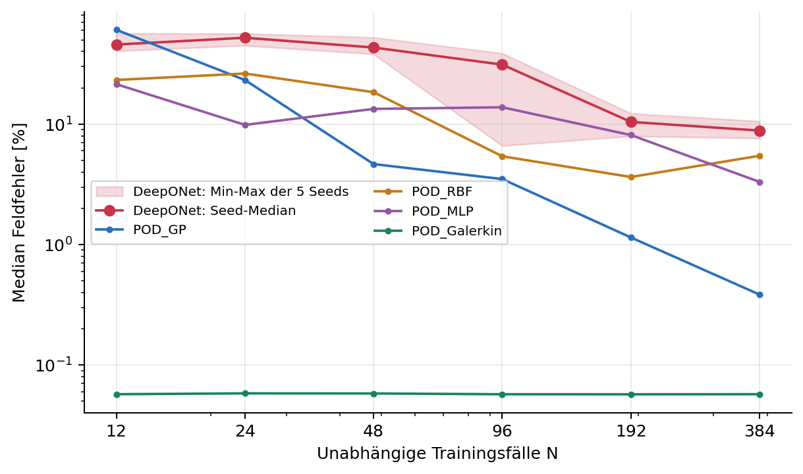
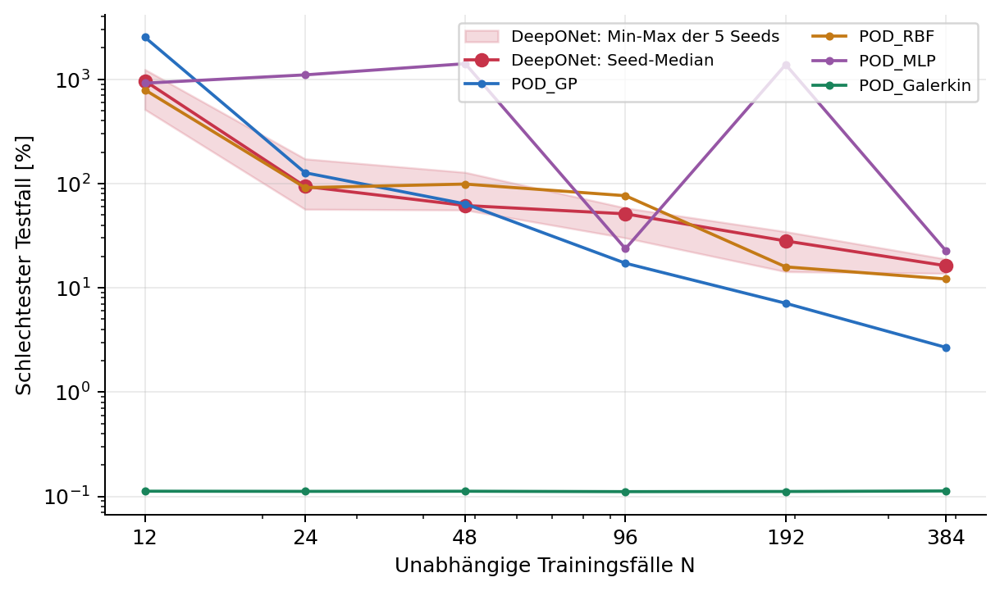
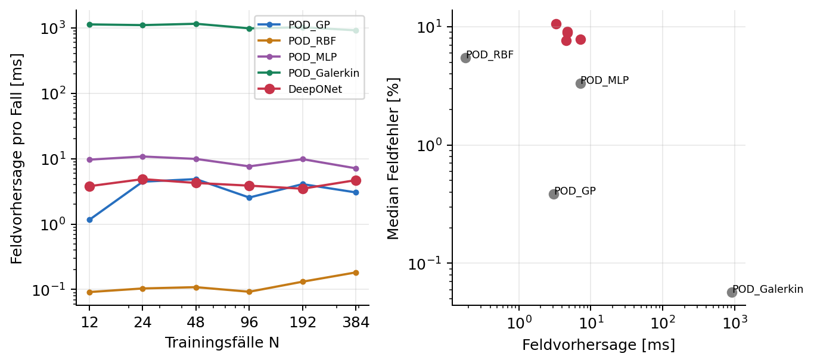
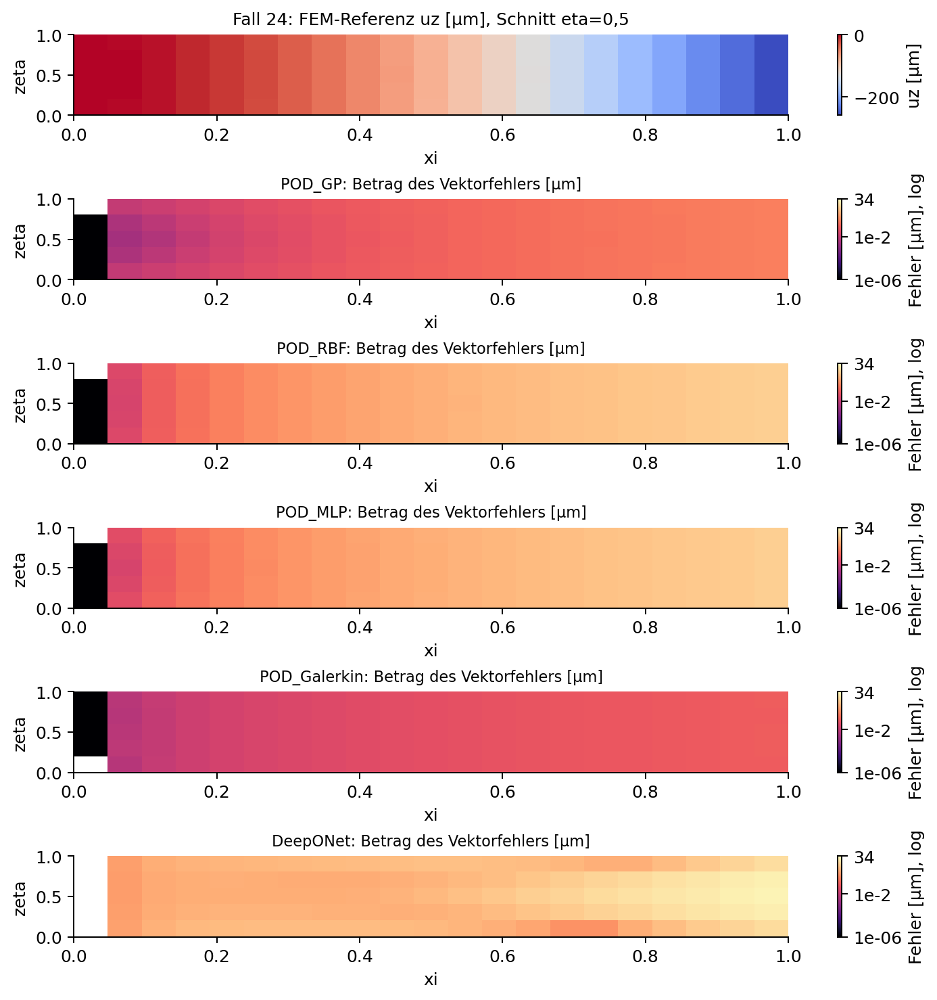
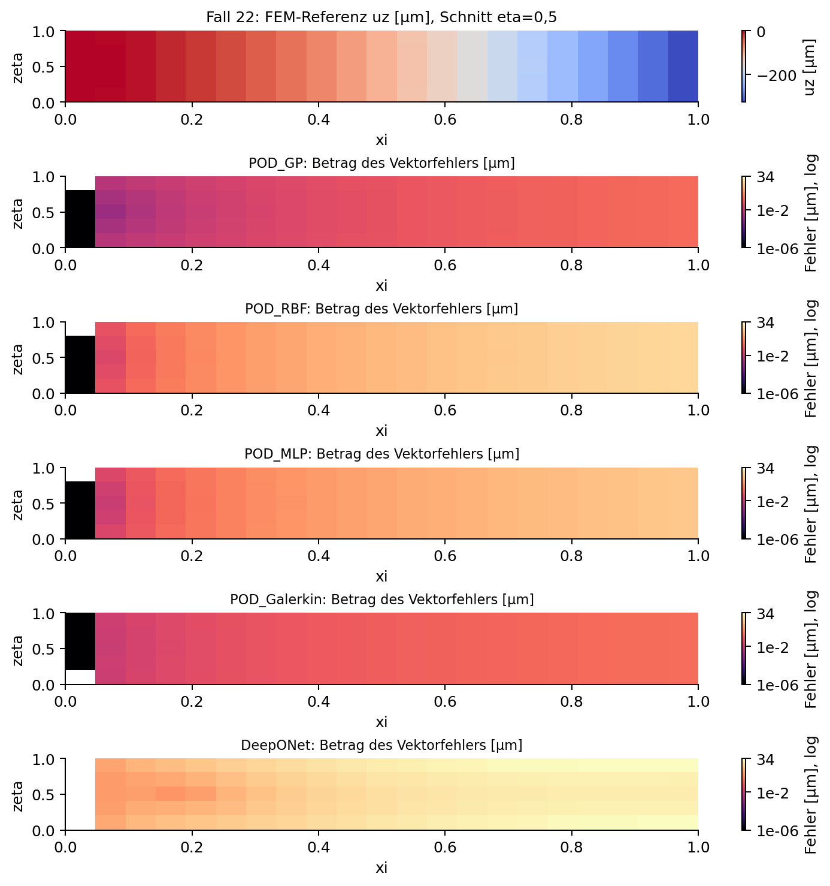
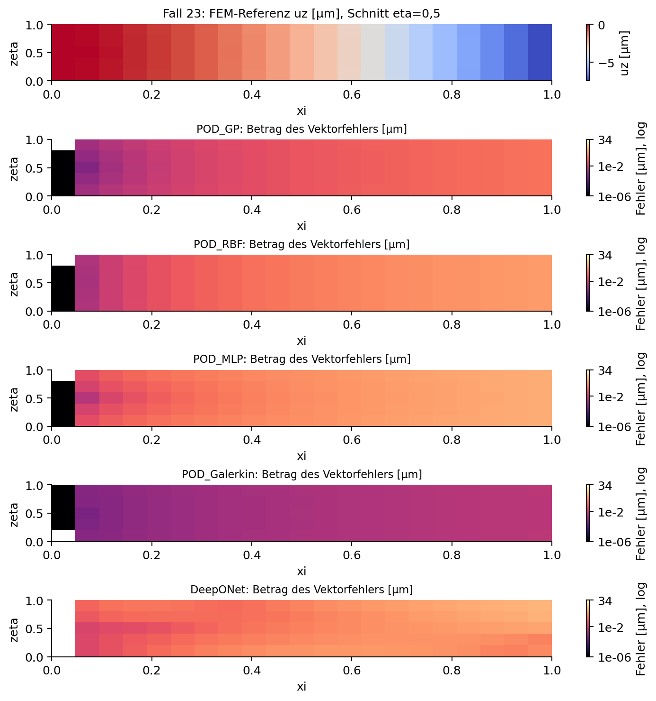

# FEM-Ersatzmodelle im Vergleich

Parametrische DeepONet-Adaption, POD-Regressoren, Balkenmodelle und klassischer POD-Galerkin-ROM

**Ausgewertete Reihe:** 12, 24, 48, 96, 192 und 384 Trainingsfälle; fünf feste DeepONet-Seeds je Größe. Stand: 25.10.2026. MATLAB R2025b Update 1, Ausführung über MATLAB MCP.

**Gemessen bei N=384:** DeepONet erreicht über die fünf Seeds einen Median der fallweisen Medianfehler von 8,835 %. Die Seed-Spanne beträgt 7,626 bis 10,568 %. POD-GPR liegt bei 0,384 %, der klassische ROM bei 0,057 %.

Der Vergleich bewertet die Parameterinterpolation derselben linear-elastischen Quaderfamilie auf sechs bereits bekannten Testfällen. Er belegt weder neue Topologien noch Extrapolation, Spannungsgenauigkeit oder allgemeine Zuverlässigkeit.

Die neue Architektur ist tatsächlich gemeinsam in Parameter- und Ortsdarstellung trainiert. Ihre räumliche Flexibilität allein ist kein Nachweis besseren Geometrietransfers. Bestehende Modelle wurden nicht nachtrainiert; neue FEM-Rechnungen waren für diese Erweiterung nicht erforderlich.

Berichtsquelle: REPORT.md und build_report.py. Messwerte, vollständige Modellstände, Checkpoints und Konfiguration liegen im zugehörigen Experimentordner.


---

## 1 | Physik und Zielgrößen

Untersucht wird ein homogener isotroper Quaderbalken in linearer statischer 3D-Elastizität: div(sigma)=0, sigma=lambda tr(epsilon) I + 2 mu epsilon, epsilon=sym(grad u), lambda=E nu/((1+nu)(1-2nu)), mu=E/(2(1+nu)). Körperkräfte sind null. An der linken Stirnfläche gilt u=0; rechts wirkt eine konstante Traktion [0,0,Fz/(b h)]. Die übrigen Flächen sind lastfrei.

| Parameter | Bereich | Einheit |
| --- | --- | --- |
| L | 0,6 bis 1,2 | m |
| b | 0,06 bis 0,10 | m |
| h | 0,08 bis 0,14 | m |
| E | 70 bis 210 | GPa (intern Pa) |
| nu | 0,25 bis 0,35 | dimensionslos |
| Fz | -1000 bis -100 | N |


Referenzraum [0,1]³: x=L(xi-0,5), y=b(eta-0,5), z=h zeta. Die feste Abfrageanordnung umfasst 21 × 5 × 5 = 525 Punkte. Feldvektoren haben die Länge 1575 und die Blockreihenfolge [alle ux; alle uy; alle uz]. Verschiebungen werden in Metern gespeichert.

Spitzenverschiebung bedeutet das signierte uz am rechten Stirnflächenmittelpunkt (xi,eta,zeta)=(1; 0,5; 0,5). Das Gittermaximum ist max sqrt(ux²+uy²+uz²) über dieselben 525 Punkte. Es ist kein garantiertes kontinuierliches Körpermaximum.

Die verwendete Norm ist e_j=sqrt(sum_i w_i (u_ij-uRef_ij)² / sum_i w_i uRef_ij²). Tensorprodukt-Trapezgewichte summieren sich je Komponente zu eins, über alle Komponenten zu drei. Auf einem Quader hebt sich die konstante physikalische Volumenskalierung im relativen Fehler auf. Die Einspannung wird am gesamten linken Abfragegitter separat geprüft.


---

## 2 | Datenentstehung und Trennung

Vorhandene Originaldaten: quadratische Tetraeder, fallweise generateMesh mit Hmax=min(b,h)/3. Material und Last werden pro Fall gesetzt. Die FEM-Lösung wird mit interpolateDisplacement auf das Referenzgitter abgebildet; Clamp-Punkte werden explizit auf null gesetzt. Rohknoten, Elemente und nodale Verschiebungen bleiben gespeichert.

| N | Trainings-IDs | neu hinzugefügte IDs / Design-Seed |
| --- | --- | --- |
| 12 | 1-12 | ursprünglicher Smoke; Training 1001 |
| 24 | 1-12, 25-36 | erste 12 aus Zusatz-LHS 20261023 |
| 48 | 1-12, 25-60 | vollständiges Zusatz-LHS 20261023 |
| 96 | 1-12, 25-108 | 61-108; Seed 20261024 |
| 192 | 1-12, 25-204 | 109-204; Seed 20261025 |
| 384 | 1-12, 25-396 | 205-396; Seed 20261026 |


Validierung sind unverändert IDs 13-18, Test IDs 19-24. Ursprüngliche Sampling-Seeds: Training 1001, Validierung 11001, Test 21001. Zusätze verwenden randomisierte Latin-Hypercube-Samples im gleichen Parameterquader. Die verschachtelten Gesamtmengen sind nicht jeweils neu optimierte LHS-Designs. Die gespeicherten Design-CSV mit 17 signifikanten Stellen sind maßgeblich.

Alle 396 Parameterzeilen sind eindeutig. Sämtliche Splits sind disjunkt; Validierungs- und Testdateien sind zwischen Größen vollständig identisch. 525 Punkte eines Balkens bilden einen physikalischen Fall und erhöhen die unabhängige Fallzahl nicht. Die volle Trainingsmenge umfasst 384 Fälle und keinerlei Holdout-Fälle.

Vorhandene Netzprüfung: zwei ausgewählte Geometrien, Divisoren 2, 3, 4 und 5. Relative Änderung des ungewichteten Gitterfeldes zum jeweils gröberen Netz:

| Fall | Divisor 3 | Divisor 4 | Divisor 5 |
| --- | --- | --- | --- |
| 1 | 0,1794 % | 0,0662 % | 0,0268 % |
| 2 | 0,0651 % | 0,0280 % | 0,0136 % |


Das zeigt Verfeinerungsstabilität an zwei Beispielen, keine flächendeckende Konvergenz oder exakte Kontinuumslösung. Der vorhandene ROM nutzt einen anderen affinen gemeinsamen FEM-Raum; dessen Test-Netzabweichung zur Originalreferenz beträgt im Median etwa 0,0601 %, maximal 0,1117 %. Für DeepONet wurden keine neuen FEM-Samples erzeugt.


---

## 3 | Was die Verfahren untersuchen

| Verfahren | Abbildung und untersuchte Frage |
| --- | --- |
| Scalar_GPR | Zwei separate Gaußprozesse bilden die sechs Parameter auf Spitze und Gittermaximum ab. Wie gut lassen sich nur skalare Zielgrößen lernen? |
| Balkentheorie | Euler-Bernoulli-Spitze Fz L³/(3 E I), I=b h³/12. Liefert die einfache Mechanik bereits einen guten skalaren Referenzwert? |
| Beam_plus_GPR | Gaußprozess lernt nur die FEM-Abweichung von dieser Balkenspitze. Hilft eine bekannte physikalische Näherung beim skalaren Lernen? |
| POD_GP | Gewichtete, zentrierte Trainings-POD; Gaußprozesse für Koeffizienten. Wie gut trägt eine feste datenbasierte Feldbasis? |
| POD_RBF | Gleiche POD-Idee; kubische Radialbasis mit linearem Polynom für Parameter-Koeffizienten-Abbildung. |
| POD_MLP | Gleiche POD-Idee; neuronales tanh-Netz lernt ausschließlich POD-Koeffizienten, nicht die räumliche Basis. |
| POD_Galerkin | Unzentrierte nodale Trainingsbasis im gemeinsamen FEM-Raum; Koeffizienten aus Kr a=fr mit Kr=Vᵀ K V. Mechanischer ROM, kein gelernter Regressor. |
| DeepONet | Branch lernt Parameterkoeffizienten, Trunk gleichzeitig räumliche Funktionen. Kann eine gemeinsame lernbare Darstellung die festen POD-Regressoren ersetzen? |


Bestehende POD-Regressoren wählen Rang und weitere Kandidaten anhand der Validierung; Kandidatenränge [2,4,8,11]. MLP-Breiten [32,64], zwei tanh-Schichten, höchstens 300 Epochen. GP: standardisierte Ausgaben und ARD-Matern-5/2-Kernel; RBF-Regularisierung [0, 1e-8, 1e-6, 1e-4]. Ein vorhandener Modell-Seed 42. Diese Altmodelle erhalten keine nachträglich erfundene Seed-Streuung.

ROM: 5586 gemeinsame Knoten, 3257 quadratische Tetraeder, 16509 freie Freiheitsgrade; Kandidatenränge [1,2,4,8,11]. Vollständige Geometrie und Steifigkeit werden online assembliert. Deshalb zählt die gesamte Assemblierung zur Online-Zeit. Seine frühere zusätzliche Snapshot-Erzeugung wird als historischer Aufwand getrennt berichtet.


---

## 4 | Parametrische DeepONet-Adaption

Branch-Eingang ist der endliche Parametervektor (L,b,h,E,nu,Fz), keine diskretisierte freie Eingabefunktion. Deshalb lautet die genaue Bezeichnung parametrische DeepONet-Adaption. Trunk-Eingang sind Referenzkoordinaten (xi,eta,zeta). Es wurde genau diese eine zusätzliche Architekturklasse implementiert.

Beide Netze bestehen aus zwei voll verbundenen tanh-Schichten gleicher Breite und einer linearen Ausgabeschicht. Der Trunk erzeugt p räumliche Features t_k. Der Branch erzeugt drei getrennte Blöcke b_ck der Länge p, je einen für ux, uy, uz. Ihre Verknüpfung ist:

**u_c(X,xi,eta,zeta) = s_u · xi · sum(k=1..p) b_ck(Z(X)) t_k(2[xi,eta,zeta]-1).**

Der Faktor xi erzwingt u=0 bei xi=0 in allen drei Komponenten, ohne eine zusätzliche Rotationsrandbedingung aufzuzwingen. Gemeinsame Trunk-Features werden mit komponentenspezifischen Branch-Koeffizienten kombiniert. Branch und Trunk werden gemeinsam differenziert und optimiert; keine vorab gelernte oder eingefrorene POD-Basis wird benutzt.

Eingang Z=(X-Trainingsmittel)/Trainingsstandardabweichung. Eine einzige gemeinsame physikalische Verschiebungsskala s_u=sqrt(mean_j sum_i w_i uRef_ij²) stammt ausschließlich aus den jeweiligen Trainingsfeldern. Alle drei Komponenten verwenden dieselbe Skala. Die Koordinatentransformation [-1,1] ist durch den Referenzraum festgelegt.

Verlust = Mittel über physikalische Fälle der gewichteten relativen quadrierten Feldfehler. Die Nenner stammen im Training ausschließlich aus den Trainingszielen; zur Vorhersage wird kein Zielwert benötigt. Dadurch erhält jeder Fall das gleiche Gewicht, anstatt große Auslenkungen oder zusätzliche Punkte als zusätzliche Fälle zu zählen. Die Komponenten tragen entsprechend ihrer physikalischen Verschiebungsenergie bei; sehr kleine ux/uy können trotz gutem Gesamt-L2 schlechter sein.

Effizienz: Branch einmal für alle Fälle im Batch, Trunk einmal für alle Abfragepunkte, anschließend drei Matrixprodukte. Training verwendet sämtliche Fälle einer Größe in einem vollständigen Batch und das vorhandene Gitter. Auswertung benötigt keine FEM-Matrix und kann beliebige Referenzpunkte entgegennehmen; Erfolg an neuen Punkten wird hier nicht durch neue FEM-Labels validiert.


---

## 5 | Auswahl, Prüfungen und Wiederaufnahme

Vorab festgelegtes Suchbudget: zwei Kandidaten je N, beide Seed 42. Kandidat 1: Breite 32, p=16; Kandidat 2: Breite 64, p=32. Adam startet mit 0,001, halbiert nach jeweils 500 Epochen, Maximum 1500 Epochen. Validierung alle zehn Epochen (zusätzlich Epoche 1), Abbruch nach 30 Prüfungen ohne relative Verbesserung von mindestens 1e-5. Das beste Validierungsmodell bleibt erhalten.

Auswahlkriterium ist der mittlere quadrierte relative Validierungs-Feldfehler. Gewinner-Seed 42 wird wiederverwendet, weitere Seeds 43-46 werden mit derselben gewählten Konfiguration trainiert. Insgesamt 12 Such-Fits und 24 weitere Fits, also 36 reguläre Trainingsläufe und 30 finale Modelle. Testdaten dienen niemals zur Architektur-, Epoche- oder Seed-Auswahl. Alle 30 Modelle mussten vor der offiziellen Testauswertung vorliegen.

| Prüfung | Tatsächlicher Status |
| --- | --- |
| Daten-/Split-Audit | Bestanden: alle sechs Größen, disjunkte IDs, identische Holdouts, Gitter, Gewichte und Spitze. |
| Tensoren und Komponenten | matlab.unittest: Dimension 1575×N und separat nachgerechneter uy-Block bestanden. |
| Gradienten | Verlust sowie sämtliche Branch-/Trunk-Gradienten endlich. |
| Winziger Trainingssatz | Zwei Fälle, 3000 Epochen; maximaler Trainings-Feldfehler unter 3 %. Dies ist keine exakte Memorierung bis Maschinengenauigkeit. |
| Einspannung | Exakt null an allen Clamp-Abfragepunkten, einschließlich sämtlicher offizieller DeepONet-Tests. |
| Einzel-/Batchausgabe | Relative Differenz unter 2e-5; bestanden. |
| Checkpoint-Wiederherstellung | Separater Test stellt das beste Netz aus dem vollständigen Checkpoint wieder her; bitidentische Vorhersage. |
| Punktpermutation | Umgekehrte Abfragereihenfolge ergibt entsprechend umgeordnete identische Felder; bestanden. |
| Vollständiger Probelauf | Interner Split der ursprünglichen Trainingsfälle: IDs 1-4 Training, 5-6 Validierung, 7-8 Test; 100 Epochen. Kein offizieller Test zur Auswahl. |


Checkpoint alle 100 Epochen, beim Abbruch und am Ende: aktuelles/bestes Netz, Adam-Momente, Epoche, Geduldzähler, Historie und Zeiten. Ein existierendes finales Modell wird unverändert zurückgegeben. Jeder reguläre Schritt protokolliert PASS/FAIL und Laufzeit; Fehler werden nicht als fehlende erfolgreiche Zeile verdeckt.


---

## 6 | Feldgenauigkeit und Seed-Streuung





Band: Minimum bis Maximum über fünf Trainingsinitialisierungen derselben Datenmenge; Linie: Median der fünf Kennzahlen. Dies ist kein Konfidenzintervall und keine Wiederholung des Daten-Samplings. Altmodelle besitzen jeweils nur einen gespeicherten Seed. Bei sechs Testfällen entspricht MATLAB prctile(...,95) hier dem Maximum.


---

## 7 | Alle Trainingsgrößen im Vergleich

| N | DeepONet Median [%] | Seed-Spanne [%] | DeepONet P95 [%] | POD-GP [%] | POD-RBF [%] | POD-MLP [%] | ROM [%] |
| --- | --- | --- | --- | --- | --- | --- | --- |
| 12 | 45,756 | 40,430 - 56,617 | 966,453 | 60,652 | 23,258 | 21,458 | 0,057 |
| 24 | 52,130 | 44,919 - 56,465 | 93,939 | 23,247 | 26,307 | 9,851 | 0,058 |
| 48 | 43,260 | 38,110 - 52,459 | 61,614 | 4,656 | 18,409 | 13,374 | 0,058 |
| 96 | 31,177 | 6,603 - 38,753 | 51,238 | 3,497 | 5,406 | 13,799 | 0,057 |
| 192 | 10,429 | 7,951 - 12,277 | 28,162 | 1,144 | 3,636 | 8,109 | 0,057 |
| 384 | 8,835 | 7,626 - 10,568 | 16,285 | 0,384 | 5,459 | 3,314 | 0,057 |


Alle Kennzahlen in dieser Tabelle sind Prozent. DeepONet-Zellen zeigen jeweils den Median über Seeds, die Spanne alle fünf. P95 ist zunächst pro Seed über sechs Fälle berechnet, dann über Seeds medianisiert. Der schlechteste Seed-Fall wird zusätzlich ausgewiesen:

| N | Schlechtester Fehler über 5×6 Tests [%] | Median Spitzen-MAE über Seeds [µm] | Median Gittermax.-MAE [µm] |
| --- | --- | --- | --- |
| 12 | 1242,831 | 60,472 | 56,447 |
| 24 | 172,572 | 65,961 | 63,281 |
| 48 | 128,026 | 57,855 | 57,266 |
| 96 | 58,397 | 45,137 | 45,670 |
| 192 | 34,573 | 12,429 | 12,548 |
| 384 | 18,894 | 11,774 | 12,090 |


Ein kleiner Median allein kann problematische Fälle verbergen. Der sehr große historische POD-MLP-Ausreißer bei N=192 bleibt in den Vergleichsdaten und im Worst-Case-Diagramm sichtbar. Alle neuen Seed-Läufe sind in der folgenden Tabelle enthalten; keine Auswahl nach Testfehler.


---

## 8 | Vollständige DeepONet-Seed-Ergebnisse

| N | Seed | Median [%] | P95 / Max [%] | Spitze MAE [µm] | Best-Epoche | Fit [s] |
| --- | --- | --- | --- | --- | --- | --- |
| 12 | 42 | 56,617 | 514,352 | 74,332 | 90 | 11,0 |
| 12 | 43 | 40,430 | 1044,278 | 50,881 | 70 | 18,4 |
| 12 | 44 | 45,756 | 1242,831 | 60,472 | 90 | 13,2 |
| 12 | 45 | 40,953 | 966,453 | 52,450 | 80 | 12,0 |
| 12 | 46 | 54,580 | 549,948 | 72,241 | 70 | 11,0 |
| 24 | 42 | 56,465 | 108,020 | 72,505 | 140 | 12,1 |
| 24 | 43 | 52,130 | 77,206 | 62,090 | 110 | 13,0 |
| 24 | 44 | 44,919 | 172,572 | 61,441 | 150 | 13,2 |
| 24 | 45 | 52,169 | 93,939 | 65,961 | 130 | 12,9 |
| 24 | 46 | 46,169 | 56,695 | 68,782 | 90 | 12,1 |
| 48 | 42 | 52,459 | 59,784 | 79,487 | 100 | 11,5 |
| 48 | 43 | 41,069 | 73,503 | 55,565 | 140 | 14,2 |
| 48 | 44 | 43,290 | 128,026 | 58,961 | 130 | 13,5 |
| 48 | 45 | 43,260 | 61,614 | 57,855 | 110 | 11,7 |
| 48 | 46 | 38,110 | 55,768 | 53,127 | 110 | 13,2 |
| 96 | 42 | 36,587 | 58,397 | 59,710 | 230 | 17,6 |
| 96 | 43 | 31,177 | 52,278 | 45,137 | 220 | 19,6 |
| 96 | 44 | 6,603 | 30,122 | 10,029 | 1500 | 51,5 |
| 96 | 45 | 9,376 | 41,140 | 12,345 | 1500 | 48,4 |
| 96 | 46 | 38,753 | 51,238 | 64,295 | 120 | 16,9 |
| 192 | 42 | 11,379 | 34,573 | 12,429 | 960 | 48,8 |
| 192 | 43 | 10,429 | 14,280 | 12,518 | 990 | 48,7 |
| 192 | 44 | 12,277 | 28,162 | 11,166 | 970 | 50,9 |
| 192 | 45 | 8,931 | 16,626 | 12,860 | 1500 | 206,0 |
| 192 | 46 | 7,951 | 34,397 | 11,531 | 1500 | 249,4 |
| 384 | 42 | 10,568 | 18,605 | 11,774 | 1500 | 297,7 |
| 384 | 43 | 8,835 | 14,366 | 10,298 | 890 | 37,5 |
| 384 | 44 | 7,798 | 16,285 | 15,471 | 1500 | 108,9 |
| 384 | 45 | 9,085 | 13,761 | 17,264 | 1500 | 29,0 |
| 384 | 46 | 7,626 | 18,894 | 11,061 | 1500 | 28,6 |


CSV-Rohwerte speichern relative Fehler als Verhältnis und Verschiebungen in Metern. Diese Tabelle skaliert Feldfehler mit 100 und Verschiebungen mit 10⁶.


---

## 9 | Gemeinsame skalare Zielgrößen

Bei N=384 ergeben sich folgende MAE. Skalare Modelle werden nur in ihren vorhandenen Ausgaben verglichen. DeepONet-Werte zeigen die Median-Kennzahl über alle fünf Seeds und keine ausgesuchte Initialisierung.

| Modell | Spitzen-MAE [µm] | Gittermaximum-MAE [µm] | Einspannfehler [m] |
| --- | --- | --- | --- |
| Scalar_GPR | 0,72856 | 0,72996 | - |
| Beam_plus_GPR | 0,00767 | - | - |
| POD_GP | 0,74102 | 0,74420 | 0,000000000000 |
| POD_RBF | 7,53186 | 7,54032 | 0,000000000000 |
| POD_MLP | 5,45325 | 5,46187 | 0,000000000000 |
| Beam_theory | 0,45330 | - | - |
| POD_Galerkin | 0,07927 | 0,08021 | 0,000000000000 |
| DeepONet (5 Seeds) | 11,77365 | 12,09048 | exakt 0 |


Alle skalaren Größen der Feldmodelle werden aus demselben vollständigen Gitterfeld abgeleitet. Feld-L2 und absolute Spitzen-MAE gewichten die Fälle unterschiedlich; ein Modell kann deshalb bei einer Kennzahl besser und bei einer anderen schlechter sein. Die Balkenkorrektur enthält bewusst nur ein skalares Ziel und darf nicht als Feldmodell bewertet werden.

| N | Scalar_GPR Spitze [µm] | Beam+GPR Spitze [µm] | Balkentheorie Spitze [µm] |
| --- | --- | --- | --- |
| 12 | 110,2806 | 0,5068 | 0,4533 |
| 24 | 39,5396 | 0,1359 | 0,4533 |
| 48 | 19,1077 | 0,1145 | 0,4533 |
| 96 | 4,0849 | 0,0802 | 0,4533 |
| 192 | 3,3350 | 0,0248 | 0,4533 |
| 384 | 0,7286 | 0,0077 | 0,4533 |


---

## 10 | Rang und Projektionsuntergrenze

| N | Modell | Rang | Projektionsmedian [%] | tatsächlicher Median [%] |
| --- | --- | --- | --- | --- |
| 12 | POD_GP | 2 | 0,04972 | 60,6522 |
| 12 | POD_RBF | 11 | 0,00108 | 23,2579 |
| 12 | POD_MLP | 4 | 0,01491 | 21,4584 |
| 12 | POD_Galerkin | 8 | 0,00498 | 0,0571 |
| 24 | POD_GP | 11 | 0,00058 | 23,2465 |
| 24 | POD_RBF | 11 | 0,00058 | 26,3073 |
| 24 | POD_MLP | 2 | 0,06395 | 9,8507 |
| 24 | POD_Galerkin | 11 | 0,00266 | 0,0581 |
| 48 | POD_GP | 11 | 0,00038 | 4,6562 |
| 48 | POD_RBF | 11 | 0,00038 | 18,4086 |
| 48 | POD_MLP | 4 | 0,01244 | 13,3738 |
| 48 | POD_Galerkin | 11 | 0,00291 | 0,0580 |
| 96 | POD_GP | 11 | 0,00031 | 3,4969 |
| 96 | POD_RBF | 11 | 0,00031 | 5,4063 |
| 96 | POD_MLP | 4 | 0,01248 | 13,7990 |
| 96 | POD_Galerkin | 8 | 0,00484 | 0,0571 |
| 192 | POD_GP | 11 | 0,00028 | 1,1444 |
| 192 | POD_RBF | 11 | 0,00028 | 3,6363 |
| 192 | POD_MLP | 4 | 0,01252 | 8,1089 |
| 192 | POD_Galerkin | 8 | 0,00476 | 0,0570 |
| 384 | POD_GP | 11 | 0,00029 | 0,3839 |
| 384 | POD_RBF | 11 | 0,00029 | 5,4593 |
| 384 | POD_MLP | 4 | 0,01281 | 3,3136 |
| 384 | POD_Galerkin | 8 | 0,00468 | 0,0572 |


POD-Projektion: gewichtetes bestmögliches Testfeld im gewählten Ausgaberaum, bei KI-POD mit Trainingsmittelwert. Beim ROM wird O V statt nodaler Koordinaten gegen das Originalgitter projiziert. Die diagnostischen Test-Projektionskoeffizienten werden niemals zur eigentlichen Vorhersage benutzt. Kleine Projektionsfehler bei größerem Regressionsfehler sprechen für die Parameterabbildung als Engpass.

Der ROM minimiert den Energiefehler im gemeinsamen FEM-Raum, nicht den Ausgabe-L2-Abstand zur anders vernetzten Originalreferenz. Historisch geprüft: maximales projiziertes Residuum 4,65e-11, freies vollständiges Residuum bis 32,96 %, Energiefehler bis 0,2555 %. Kleine Ausgabefehler bedeuten daher nicht exakt erfüllte freie FEM-Gleichungen.


---

## 11 | Hardware und tatsächliche Rechenkosten

Hardware: AMD Ryzen 5 4500U with Radeon Graphics, 6 Kerne / 6 logische Prozessoren; Windows. MATLAB 25.2.0.3042426 (R2025b) Update 1. Neue DeepONets rechnen auf CPU mit Single-Precision-Netzen; Altmodelle/ROM nutzen ihre vorhandene numerische Präzision auf derselben CPU. Keine GPU-Auswertung, daher keine GPU-Synchronisationszeit.



Neue Zeitmessung pro Methode/Fall: ein Warmup, fünf Wiederholungen, vollständiges Feld einschließlich Skalierung/Rekonstruktion. Tabelle: Median aller 30 Messungen pro Modell; DeepONet anschließend Median über Seeds. Scalar-Zeiten beziehen sich nur auf deren skalare Ausgaben und sind kein identischer Arbeitsumfang. Laden des Modells und Fehlerdiagnostik sind nicht Teil der Online-Inferenz. Kleine Zeitunterschiede sind wegen Systemlast, Caches und Timerauflösung nicht als robuste Beschleunigung zu interpretieren.

| N | DeepONet [ms] | POD-GP [ms] | POD-RBF [ms] | POD-MLP [ms] | ROM [ms] |
| --- | --- | --- | --- | --- | --- |
| 12 | 3,796 | 1,164 | 0,091 | 9,653 | 1126,456 |
| 24 | 4,863 | 4,443 | 0,104 | 10,781 | 1098,079 |
| 48 | 4,250 | 4,868 | 0,109 | 9,902 | 1151,907 |
| 96 | 3,864 | 2,544 | 0,092 | 7,622 | 980,004 |
| 192 | 3,471 | 4,080 | 0,132 | 9,820 | 1018,618 |
| 384 | 4,690 | 3,047 | 0,182 | 7,116 | 914,722 |


---

## 12 | Offline-Aufwand und Suchbudget

| N | gewählt Breite / p | Parameter | Suche 2 Fits [s] | 5 finale Fits [s] | zusätzliche 4 Fits [s] | Vorbereitung 5 Fits [s] |
| --- | --- | --- | --- | --- | --- | --- |
| 12 | 64 / 32 | 17344 | 25,2 | 65,6 | 54,6 | 6,878 |
| 24 | 64 / 32 | 17344 | 26,3 | 63,4 | 51,3 | 1,479 |
| 48 | 64 / 32 | 17344 | 24,3 | 64,1 | 52,5 | 1,565 |
| 96 | 64 / 32 | 17344 | 34,7 | 154,0 | 136,4 | 1,363 |
| 192 | 64 / 32 | 17344 | 104,5 | 603,8 | 555,0 | 2,005 |
| 384 | 32 / 16 | 4576 | 360,9 | 501,7 | 204,0 | 3,311 |


Realer regulärer Optimierungsaufwand = beide Such-Fits + vier weitere Seeds je N. Die fünf finalen Fits enthalten den wiederverwendeten Gewinner-Seed 42 und werden nicht nochmals komplett zur Suche addiert. Fit-Zeit enthält laufende Validierung, aber keine Checkpoint-Schreibintervalle. Vorbereitung enthält Skalierung und Netzaufbau. events.csv misst die Gesamt-Schrittzeiten mit Dateiladen, Checkpoints und finalem Speichern; die Logausgabe folgt anschließend.

Eine ergänzende, separat gemessene Wiederholung der Datenaufbereitung nach dem Training ist in data_preparation.csv enthalten: warme Ladezeit von Training/Validierung und reine Skalierungszeit, getrennt von Netztraining. Diese warmen Nachmessungen werden nicht als ursprünglich kalte Trainings-I/O ausgegeben. Sämtliche daraus berechneten Trainingsmittel, Standardabweichungen und Verschiebungsskalen stimmen exakt mit allen 30 Modellen überein.

| N | Warme Ladezeit [ms] | Skalierung [ms] | gemeinsame Skala [µm] |
| --- | --- | --- | --- |
| 12 | 33,110 | 5,529 | 89,401 |
| 24 | 18,668 | 2,840 | 101,590 |
| 48 | 17,770 | 0,814 | 98,120 |
| 96 | 19,636 | 2,424 | 99,242 |
| 192 | 32,961 | 6,082 | 106,491 |
| 384 | 47,781 | 3,351 | 110,348 |


Optimierung inklusive Suche: 1629,8 s; protokollierte Schrittzeiten inklusive I/O: 1740,1 s. Tiny-Overfit und Workflow-Smoke sind separat. Fehlgeschlagene reguläre Schritte: 0; events.csv und failure_notes.md dokumentieren Fehler und Korrekturen.

Datengewinnung ist hier ein bereits vorhandener Aufwand. Es wurden keine FEM-Fälle für DeepONet neu berechnet. Historische FEM-Zeiten der Originalfälle und zusätzliche gemeinsame ROM-Snapshots sind nicht mit reiner Fit-Zeit gleichzusetzen. Der vorhandene ROM benötigte 396 zusätzliche gemeinsame Snapshots, zusammen rund 497,69 s, und etwa 28-30 s Basis-/Rangwahl pro Größe. Diese historischen Zahlen sind kein neuer kontrollierter Offline-Benchmark.

Die Trainingsreihe lief mit Unterbrechungen vom 23. bis 25.10.2026 und wechselnder Systemlast. Gespeicherte Fits werden bei Wiederaufnahme nicht erneut berechnet. Die Einzelzeiten sind gemessene Wallclock-Zeiten und kein streng kontrollierter Vergleich identischer Auslastung; insbesondere sind kurze und lange Fit-Zeiten verschiedener Tage nur eingeschränkt vergleichbar.


---

## 12a | Ausführungsweg und Komponenten

Die kleine Suche prüft zwei feste Konfigurationen, keine erschöpfende Optimierung. Ein schlechtes DeepONet-Ergebnis beweist daher nicht die Unterlegenheit jeder DeepONet-Konfiguration. Gleiche Epochenzahl bedeutet bei vollständigen Batches gleiche Zahl Adam-Updates, aber steigende Rechenarbeit pro Update bei größerem N.

Nach dem ersten 384er-Kandidaten wurde die automatische Differenzierung profiliert und der gecachte Ausführungsweg dlaccelerate geprüft. Reiner Gradientenaufruf: 0,063867 s direkt, 0,015846 s gecacht, Faktor 4,03. Gemessene Verlust- und Gradientenabweichung: jeweils exakt null. Dies ist ein Kernelvergleich, keine gemessene Beschleunigung des gesamten Trainings.

Die verbleibenden Fits (zweiter 384er-Kandidat und vier weitere Seeds) verwenden den gecachten Weg. Architektur, Verlust, Adam-Parameter und Auswahlregel bleiben gleich. Frühere finale Modelle wurden erhalten. Alle Fit-Zeiten sind tatsächlich gemessen; sie stammen damit aus zwei dokumentierten Ausführungswegen. source_snapshot_pre_cache bewahrt den zuvor verwendeten direkten Trainer; source_snapshot den finalen Stand. Profil und Benchmark liegen separat vor.

Zusätzliche Komponentendiagnose bei N=384: je Komponente Median und Maximum über alle 5 Seeds mal 6 Testfälle. Die relative Komponentennorm bezieht sich jeweils nur auf die betreffende Referenzkomponente. Sie ist daher nicht mit dem gemeinsamen Feldfehler gleichzusetzen.

| Komponente | Median relativ [%] | Maximum relativ [%] | Median abs. RMS [µm] |
| --- | --- | --- | --- |
| ux | 34,442 | 131,683 | 2,229 |
| uy | 1466,171 | 5186,950 | 0,858 |
| uz | 7,909 | 15,222 | 6,238 |


Die gemeinsame physikalische Verschiebungsskala und die Energienorm bevorzugen keine künstlich separat normierte kleine Komponente. Für Anwendungen mit hohen Anforderungen an kleine Komponenten ist diese Diagnose wichtiger als ein einzelner Gesamtfehler.


---

## 13 | Räumliche Diagnose: gut, Fall 24

N=384, vorab fester DeepONet-Seed 42. Kategorien nach dessen sechs Testfehlern: kleinster, unterer mittlerer und größter Fehler. Diese nachträgliche Bildauswahl dient nur der Diagnose und ändert keine Modellwahl.



Gleiche logarithmische Fehlerfarbskala in sämtlichen Methoden und allen drei Fällen; weiße Einspannpunkte haben exakt null Fehler. Dargestellt ist ein Referenzschnitt eta=0,5; die Kennzahlen nutzen weiterhin alle 525 Punkte. FEM-uz verwendet eine eigene signierte Farbskala.


---

## 13 | Räumliche Diagnose: mittel, Fall 22

N=384, vorab fester DeepONet-Seed 42. Kategorien nach dessen sechs Testfehlern: kleinster, unterer mittlerer und größter Fehler. Diese nachträgliche Bildauswahl dient nur der Diagnose und ändert keine Modellwahl.



Gleiche logarithmische Fehlerfarbskala in sämtlichen Methoden und allen drei Fällen; weiße Einspannpunkte haben exakt null Fehler. Dargestellt ist ein Referenzschnitt eta=0,5; die Kennzahlen nutzen weiterhin alle 525 Punkte. FEM-uz verwendet eine eigene signierte Farbskala.


---

## 13 | Räumliche Diagnose: schlecht, Fall 23

N=384, vorab fester DeepONet-Seed 42. Kategorien nach dessen sechs Testfehlern: kleinster, unterer mittlerer und größter Fehler. Diese nachträgliche Bildauswahl dient nur der Diagnose und ändert keine Modellwahl.



Gleiche logarithmische Fehlerfarbskala in sämtlichen Methoden und allen drei Fällen; weiße Einspannpunkte haben exakt null Fehler. Dargestellt ist ein Referenzschnitt eta=0,5; die Kennzahlen nutzen weiterhin alle 525 Punkte. FEM-uz verwendet eine eigene signierte Farbskala.


---

## 14 | Fähigkeits- und Evidenzmatrix

| Modell | Ausgaben | N | Parameter-Test | Weitere Evidenz |
| --- | --- | --- | --- | --- |
| Scalar_GPR | Spitze, Gittermaximum | alle 6 | 6 feste Fälle | kein Feld |
| Beam_plus_GPR | Spitze | alle 6 | 6 feste Fälle | kein Feld |
| Beam_theory | Spitze | datenunabhängig | dieselben 6 | analytisch; kein Feld |
| POD_GP / RBF / MLP | Feld, Spitze, Gittermax. | alle 6 | 6 feste Fälle | Clamp-Gitter; POD-Floor |
| POD_Galerkin | Feld, Spitze, Gittermax. | alle 6 | 6 feste Fälle | frühere Mechanik-/Energieprüfungen |
| DeepONet | Feld, Spitze, Gittermax. | alle 6 × 5 Seeds | 6 feste Fälle je Seed | 7 Unit-Tests, exakte Clamp-Parametrisierung |


Die vollständige maschinenlesbare Matrix capability_matrix.csv führt Modell × Ausgabegröße × jede Trainingsgröße × Testart × Prüfstatus explizit auf. Fehlende Ausgaben werden nicht mit null Fehler verwechselt. Neue Topologien, Extrapolation und Transfer auf andere Netze/Geometriefamilien sind für alle Modelle als nicht untersucht markiert.

Die früheren FEM-Skalierungs-, Assemblierungs-, Last-, Cholesky- und ROM-Einschlussprüfungen werden als vorhandene Evidenz referenziert. Sie wurden für diese rein datenbasierte Erweiterung nicht nochmals gerechnet. Neu ausgeführt wurden die DeepONet-Suite, Split-Audits, alle 36 regulären Fits und neue gemeinsame Ausgabe-/Zeitmessungen.

Grenzen: nur sechs feste Validierungs- und sechs bereits bekannte Testfälle; eine Designreihe; Seed-Streuung nur der neuen Netze; keine unabhängigen Design-Wiederholungen. Test-P95 und Maximum fallen zusammen. Die Erweiterungen wurden nach Betrachtung früherer Testergebnisse beauftragt. Der Vergleich ist explorativ, keine neue blinde Bestätigung.

Weiterhin nicht geprüft: Spannungen, lokale Spannungsspitzen, Plastizität, große Verformungen, Dynamik, wechselnde Einspannungen/Lastfunktionen, neue Topologien und Parameter außerhalb der definierten Bereiche. Die komponentenübergreifende Energienorm kann Fehler der viel kleineren Komponenten verdecken; einzelne Komponenten sollten bei entsprechenden Anwendungen zusätzlich gewichtet ausgewertet werden.


---

## 15 | Bewertung und nächster Schritt

Deskriptiver Medianvergleich gegen POD_GP: DeepONet kleinerer Feldfehler bei N=12; größerer oder gleicher Fehler bei N=24, 48, 96, 192, 384. Verglichen wird der Median aller fünf DeepONet-Seeds mit dem vorhandenen einzelnen Baseline-Modell.

Deskriptiver Medianvergleich gegen POD_RBF: DeepONet kleinerer Feldfehler bei N=keinem; größerer oder gleicher Fehler bei N=12, 24, 48, 96, 192, 384. Verglichen wird der Median aller fünf DeepONet-Seeds mit dem vorhandenen einzelnen Baseline-Modell.

Deskriptiver Medianvergleich gegen POD_MLP: DeepONet kleinerer Feldfehler bei N=keinem; größerer oder gleicher Fehler bei N=12, 24, 48, 96, 192, 384. Verglichen wird der Median aller fünf DeepONet-Seeds mit dem vorhandenen einzelnen Baseline-Modell.

Deskriptiver Medianvergleich gegen POD_Galerkin: DeepONet kleinerer Feldfehler bei N=keinem; größerer oder gleicher Fehler bei N=12, 24, 48, 96, 192, 384. Verglichen wird der Median aller fünf DeepONet-Seeds mit dem vorhandenen einzelnen Baseline-Modell.

Statistische Gleichwertigkeit wurde nicht nachgewiesen. Weder überlappende Seed-Spannen noch ähnliche Fehler auf sechs bekannten Testfällen ersetzen eine unabhängige Bestätigung.

Das neue DeepONet liegt bei N=384 im Seed-Median beim 23,01-fachen Feldfehler des vorhandenen POD-GPR. Diese Aussage bezieht sich auf die konkrete kleine Suche und die vorhandenen sechs Fälle. Die vollständigen Seed-Ergebnisse und Worst-Case-Werte sind maßgeblich; ein einzelner guter Lauf ist keine belastbare Empfehlung.

Besonders kritisch ist die kleine uy-Komponente: bei N=384 beträgt ihr komponentenbezogener relativer Medianfehler über alle Seeds und Testfälle 1466,171 %. Die gemeinsame Feldnorm wird vom größeren uz dominiert. Für Anforderungen an alle drei Komponenten ist der alleinige Feldmedian deshalb unzureichend; die Komponententabelle ist zwingend mitzulesen.

Bei N=384 ist der größte DeepONet-Fehler über alle fünf Seeds und sechs Testfälle 18,894 %, beim vorhandenen POD-MLP 22,672 %. Ein Medianvorteil und ein Vorteil beim schlechtesten bekannten Fall sind verschiedene Aussagen; diese kleine Stichprobe belegt keine sichere Tail-Garantie.

Der klassische ROM bleibt auf diesem Ausgabegitter besonders genau und datensparsam, bezahlt dies jedoch mit voller Online-Assemblierung. POD-GPR ist eine starke schnelle Feld-Baseline. Für die einzelne Spitzenverschiebung ist die physikalische Balkenkorrektur besonders effizient. DeepONet bietet eine gemeinsam lernbare Ortsdarstellung und direkt erzwungene Einspannung; ein allgemeiner Genauigkeitsvorteil folgt daraus nicht.

Empfehlung: vorhandene gute Baselines zunächst weiterverwenden. Vor größerer Hyperparametersuche oder einer Modellentscheidung einen neuen, getrennten Bestätigungstestsatz innerhalb der gleichen Parameterfamilie festlegen. Dabei Komponentenfehler, schwierige kleine Auslenkungen und Absolutfehler berücksichtigen. Erst danach gezielt untersuchen, ob mehr Trainingsbudget, andere Verlustgewichtung oder physikalisch motivierte Parametrisierung innerhalb derselben DeepONet-Klasse hilft. Solche Folgeexperimente wurden hier nicht gestartet.

Der größere frühere pilot-Lauf wurde nicht gestartet. Der interne DeepONet-Workflow-Smoke ist eine getrennte kleine Funktionsprüfung vorhandener Fälle und kein zusätzlicher FEM-Pilot.


---

## 16 | Reproduzierbarkeit und Dateien

Im MATLAB-Projektordner ausführen; vorhandene Modelle werden wiederverwendet. Für einen unabhängigen neuen Versuch einen neuen Ausgabeordner wählen, nicht alte finale Modelle löschen oder überschreiben.

addpath('src','tests')<br/>run_deeponet_study("prepare")<br/>run_deeponet_study("smoke")<br/>results = runtests('tests/deeponetTest.m'); assertSuccess(results)<br/>for N = [12 24 48 96 192 384]<br/>    run_deeponet_logged("search",N)<br/>    for seed = 42:46<br/>        run_deeponet_logged("train",N,seed)<br/>    end<br/>end<br/>for N = [12 24 48 96 192 384]<br/>    for seed = 42:46<br/>        run_deeponet_logged("evaluate",N,seed)<br/>    end<br/>end<br/>run_deeponet_logged("summarize")<br/>evaluate_deeponet_baselines<br/>export_deeponet_diagnostics<br/>% PDF außerhalb MATLAB: python build_report.py

```matlab
addpath('src','tests')
run_deeponet_study("prepare")
run_deeponet_study("smoke")
results = runtests('tests/deeponetTest.m'); assertSuccess(results)
for N = [12 24 48 96 192 384]
    run_deeponet_logged("search",N)
    for seed = 42:46
        run_deeponet_logged("train",N,seed)
    end
end
for N = [12 24 48 96 192 384]
    for seed = 42:46
        run_deeponet_logged("evaluate",N,seed)
    end
end
run_deeponet_logged("summarize")
evaluate_deeponet_baselines
export_deeponet_diagnostics
% PDF außerhalb MATLAB: python build_report.py
```
Direkte Vorhersage: a=load("experiments/deeponet_20261023_v1/n384/seed42/model.mat"); H=predict_deeponet(a.model,X,xi); X besitzt sechs SI-Spalten, xi drei Zeilen im Referenzraum. H ist [ux;uy;uz] in Metern.

| Dateien | Inhalt |
| --- | --- |
| protocol.mat/json; *_ids.csv | vorab festgelegtes Budget, MATLAB-Version, sämtliche Split-IDs |
| nN/candidateK; validation_selection.csv | beide Suchmodelle, Auswahlwerte und Trainingshistorien |
| nN/seedS/model.mat; checkpoint.mat | finale Modelle; bei eigenen Fits resumierbarer Optimierer |
| deeponet_summary/per_case.csv | 30 Modellzeilen, 180 fallweise Testkennzahlen |
| baseline_summary/per_case.csv | alle vorhandenen Verfahren; keine Nachtrainings |
| *_timing_samples.csv; events.csv; logs | einzelne Messungen, tatsächliche Abläufe und Fehlerstatus |
| capability_matrix.csv; representative_cases.csv | Fähigkeiten und eindeutig ausgewiesene räumliche Bildauswahl |
| source_snapshot; protected_files.json | ausgeführter neuer Quellstand und Hashschutz alter Ergebnisse |
| REPORT.md; build_report.py; figures; output/pdf | bearbeitbarer Bericht, Generator, Diagramme und PDF |


## Quellen

Lu et al. (2021): Learning nonlinear operators via DeepONet based on the universal approximation theorem of operators. Nature Machine Intelligence 3, 218-229. DOI: 10.1038/s42256-021-00302-5. Grundidee Branch/Trunk; die konkrete endliche Parameter- und Mehrkomponenten-Adaption ist oben vollständig angegeben.

MathWorks: Custom Training Loops; adamupdate; dlnetwork; dlgradient. https://www.mathworks.com/help/deeplearning/ug/custom-training-loops.html und https://www.mathworks.com/help/deeplearning/ref/adamupdate.html. Syntax zusätzlich mit lokaler R2025b-Hilfe geprüft. FEM: fegeometry, generateMesh, interpolateDisplacement und assembleFEMatrices in der PDE-Toolbox-Dokumentation.

Projektquellen: config.m, src/solve_case.m, reference_grid.m, train_models.m, run_training_size_study.m, run_rom_study.m und gespeicherte Protokolle. Historische Original- und ROM-Ergebnisse liegen unverändert in den bisherigen Experimentordnern.
